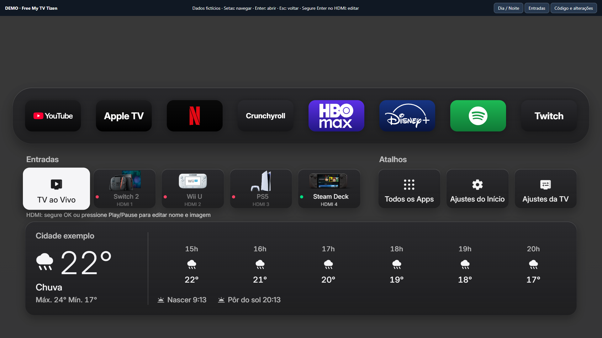

# Free My TV Tizen

Fork público de [simbasjungles/free-my-tv](https://github.com/simbasjungles/free-my-tv), com melhorias para Samsung Tizen: HDMI com nome, foto e status, editor pelo controle remoto, logotipos vetoriais e atalhos separados para Tizen e TV aberta.

**[Abrir demonstração interativa](https://gustavokrug.github.io/free-my-tv-tizen/)** · [Baixar o HTML e abrir offline](https://github.com/gustavokrug/free-my-tv-tizen/raw/refs/heads/main/docs/index.html) · [Todas as alterações](FORK-CHANGES.md) · [Documentação original](README.upstream.md)



## O que mudou

- **HDMI personalizados:** nome, foto do dispositivo e indicação da porta. Bolinhas verde/vermelha/cinza conforme o status informado pela TV.
- **Editor pelo controle:** segure OK em um HDMI ou pressione Play/Pause; escolha a imagem, edite o nome e salve. Configurações persistem entre aberturas.
- **Dispositivos:** Switch 2, Wii U, PS5, Steam Deck e HDMI genérico.
- **Disney+ e HBO Max:** logotipos SVG nítidos, maiores e sem deformação.
- **Tizen no topo:** abre a interface padrão Samsung. **TV ao Vivo no painel inferior:** abre a TV aberta pelo fluxo original.
- **Retomada do aplicativo:** manifesto preparado para operação principal, multitarefa e prelaunch.
- **Demo HTML offline:** mesma interface com dados fictícios, navegação e edição HDMI funcionais, sem acesso à TV ou serviços externos.

## Experimentar

Abra a [demonstração](https://gustavokrug.github.io/free-my-tv-tizen/) ou baixe `docs/index.html` e abra no navegador. Use **setas** para navegar, **Enter** para abrir, **Esc** para voltar e **segure Enter sobre um HDMI** para editar. O mouse também funciona. Os dados de clima e conexão são exemplos, e abrir apps apenas mostra mensagens de simulação.

Para gerar novamente o HTML, com Python 3:

```sh
python tools/build_demo.py
```

## Instalar na Samsung

Siga os requisitos de Developer Mode e certificados na [documentação original](README.upstream.md#samsung-tvs-tizen). Com seu perfil de assinatura configurado:

```sh
python tizen/build.py --sign SEU_PERFIL
python tizen/install.py IP_DA_TV
```

Edite `config.properties` localmente para sua cidade e opções. Sem chave TMDB, recomendações de filmes/séries ficam desativadas. Não publique sua configuração ou certificados.

O redirecionamento do botão Home e da inicialização foi feito localmente em uma QN85B/Tizen 6.5; não é aplicado automaticamente por este fork nem garantido em outros modelos. Consulte [detalhes e limites](FORK-CHANGES.md).

## Projeto original e créditos

O Free My TV original é desenvolvido por [simbasjungles](https://github.com/simbasjungles). Este fork preserva o histórico Git, a licença MIT e a documentação original. As alterações deste fork são mantidas por Gustavo Krug.

Fontes dos logotipos e fotos em `web/icons/vector-logo-sources.txt`, `web/icons/home-device-sources.json` e `web/icons/home-NOTICE.txt`. Marcas e imagens pertencem aos respectivos titulares.
